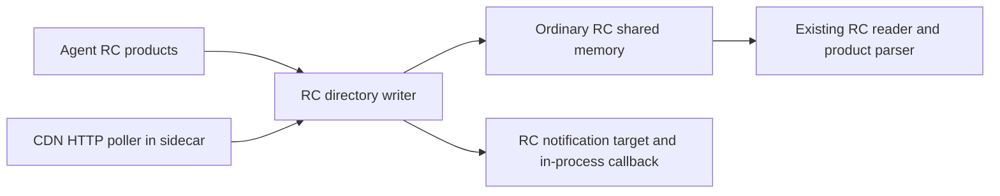

# Feature Flagging & Experimentation

This is an internal DataDog library that supports Feature Flag evaluation. It is intended for use in tracers and DataDog services. Expect frequent breaking changes and major bumps before it's stabilized.

## Subject experimentation opt-out

The caller selects `EvaluationOptions.experimentation_opt_out_mode`; the evaluator reads no environment variables.
Both enabled modes require a valid `dd_experimentation_opt_out_at` timestamp when the attribute is present.
Cutoff and activation timestamps use `YYYY-MM-DD[Tt]HH:mm:ss[.fraction](Z|z|±HH:mm)`
with ASCII digits and valid Gregorian calendar fields. Seconds are `00`–`59`;
numeric offset hours are `00`–`23` and minutes are `00`–`59`.
Fractions contain at least one digit and truncate after nine digits without rounding.
Both the written year and the normalized UTC year must be `0000`–`9999`.
Whitespace, named zones, compact offsets, and leap seconds are rejected.
The existing `startAt`/`endAt` parsing is unchanged.
Missing input preserves normal evaluation. Invalid input returns `InvalidContext` before flag lookup.

| Mode | Exposure-logging allocations |
| --- | --- |
| `Disabled` | Evaluate normally |
| `Immediate` | Skip when the subject supplies an opt-out timestamp |
| `FutureExperimentsOnly` | Skip when activation is equal to or later than opt-out, or activation is unknown |

Future mode uses `randomizationActivatedAt`, with nanosecond precision and timezone-aware comparisons.
Older allocations remain eligible; this does not prove previous enrollment.
Malformed activation rejects the affected flag only in future mode with a valid subject cutoff, including unreachable allocations.
Other modes and subjects without a cutoff do not require valid activation. Missing or null activation is unknown.
Skipped allocations produce no exposure. Ordinary allocations remain available, and evaluation telemetry is unchanged.

The C API adds `ddog_ffe_get_assignment_with_opt_out_mode`.
The existing `ddog_ffe_get_assignment_with_options` interface and boolean layout remain unchanged for immediate-mode callers.

## CDN configuration

Enable `cdn,https` to fetch managed or custom CDN configuration on an existing
Tokio runtime using ring. For FIPS builds, disable default features and select
`cdn,fips` instead; initialize the FIPS crypto provider before constructing the
fetcher, as required by `libdd-common`. `cdn` itself does not select a TLS
provider and enables the shared connector's `HTTP_PROXY`, `HTTPS_PROXY`, and
`NO_PROXY` support. Implement `ConfigurationSink` to publish accepted
configuration; return `ApplyError` if publication fails so the ETag stays at the
last accepted version. `failed` and `confirmed` report stale and recovered
delivery without deleting the last good configuration.

```rust,ignore
use libdd_ffe::cdn::{CdnConfig, CdnEndpoint, CdnFetcher};
use std::time::Duration;

let config = CdnConfig {
    endpoint: CdnEndpoint::managed("datadoghq.com", "production", &api_key)?,
    poll_interval: Duration::from_secs(30),
    request_timeout: Duration::from_secs(5),
    language: "php".into(),
    version: tracer_version,
};
let mut fetcher = CdnFetcher::new(config, configuration_sink)?;
fetcher.run(cancellation_token).await;
```

`CdnEndpoint::custom(url)` carries no Datadog API key. Redirects are not
followed; invalid API-key header values fail endpoint construction. Custom URL
Basic authentication accepts an empty username. Compressed and decoded responses
are capped at 10 MiB, including the combined output of concatenated gzip members.
Cancelling the token interrupts HTTP and retry waits. A final `Retry-After` also bounds the
wait before the next poll. Run the fetcher in the process that owns
external I/O, such as the sidecar; constructing it does not spawn a worker.

`CdnConfig::validate` identifies the invalid setting through `InvalidConfig`
variants without including URLs, credentials, or rejected values in diagnostics.

Sidecar clients queue `set_cdn_configuration(Some(CdnRegistration { .. }))` without
waiting for a reply or a returned handle. Derive `registration.invariants()`,
construct an ordinary `RemoteConfigManager` with the `UniversalFlagConfig` parser,
and track `registration.target` before checking for existing configuration.
The returned `RemoteConfigInvariants` wrapper belongs to the sidecar: its local
publication scope separates CDN identities without changing the shared RC client's
`ConfigInvariants`. Unscoped Agent publications retain their existing directory names.
`set_cdn_configuration(None)` unregisters the source. Reconnect replays the
registration through the normal sender state. Invalid registrations are logged
by the sidecar and replace the previous subscription; clients should validate
`CdnConfig` locally before selecting it.

The sidecar combines agent products and CDN flags in the writer. A CDN-selected
directory excludes agent `FFE_FLAGS` files and retains other agent products,
including before the first CDN response. Ordinary RC readers and
`IN_PROC_NOTIFY_FUN` observe that same directory. Identical accepted CDN bytes
leave its generation unchanged. Existing RC notification targets receive changes
only while the connection has an active application and RC notifications enabled;
late application registration is notified of an existing publication. Thread-mode
listeners reject CDN registration so HTTP stays outside the application process.



Retention follows RC publication semantics: a failed poll or a 304 keeps the
accepted files; a reader keeps its parsed configuration while no replacement
directory is available. A replacement writer publishes only when it has an
accepted source snapshot. Other agent products may produce that snapshot before
the first CDN response; no separate durable CDN cache or cross-restart freshness
lease is introduced. An empty *valid* CDN configuration still replaces the old
flags. Changing credentials, endpoint, or configuration identity selects a new
directory; the client must select that directory and clear its former evaluator
state rather than applying the previous identity's flags.

The publication uses the existing OS-user trust boundary and normal named RC
shared memory on each platform. It does not add sealed memfds, read-only
subscriber descriptors, a Linux kernel floor, or a second binary snapshot format.
Connections with identical registrations share one poller. Closing the last
connection cancels polling and releases its credentials and publisher; existing
readers retain their parsed last-good configuration under the normal RC rules.

`CdnEndpoint` wraps `libdd_common::Endpoint` while retaining CDN validation,
credential isolation and redacted diagnostics. URL credentials remain
case-sensitive in subscription identity. The endpoint IPC representation is
unchanged; `CdnConfig::request_timeout` remains the request deadline. Request
headers are set explicitly; entity/container headers are not part of this
configuration API.

## `flagevaluation` EVP privacy

- Each observation carries the consent captured by its SDK at evaluation time.
  Protected output is the default. Only explicit consent permits raw targeting
  identity and evaluation context in the EVP event; raw error messages are
  always replaced with standard OpenFeature error codes.
- Aggregation retains valid raw identity internally and hashes it only when
  building protected output (`sha256_` plus lowercase SHA-256 of exact UTF-8).
  A present empty identity stays empty; missing or invalid UTF-8 identity is
  omitted. Full buckets distinguish consent; degraded buckets do not and omit
  identity/context regardless of consent. Merging defensively ANDs consent.
- Context snapshots retain at most 256 leaves, inspect at most 256 entries per
  container and 1,280 nodes overall, limit depth to four, and omit keys/string
  values over 256 Unicode characters. The legacy JSON-taking FFI still parses
  the supplied JSON: these retention limits do **not** bound that parsing cost.
  A producer needing a bounded hot path must select bounded input before JSON
  conversion. The final encoder independently enforces privacy and limits.
- Field loss records `flagevaluation.context.truncated` with finite `reason`
  tags, or `flagevaluation.targeting_key.omitted` with `reason:invalid`.
  Each reason is counted once per represented evaluation, even if validation
  happens at multiple boundaries; it is not an evaluation drop. Existing
  degradation/drop metrics retain their names and units. Internal field-loss
  metadata is never sent in EVP. Event Debug output omits customer fields.

## Split features on exposures and evaluation counts

The SDK routes each split feature by destination and sends one flat JSON
object per destination: `FfeExposure.features_json` for exposures and
`FfeFlagEvaluation.features_json` for evaluation counts. Values are strings,
numbers or booleans; other values are skipped. Keys or strings over 256
Unicode characters are skipped. Features are kept in sorted key order, up to
256 features and 4096 bytes of canonical JSON; the rest are dropped. Numbers
are written as doubles. Empty, invalid or non-object JSON means no features
and never rejects the event.

- Exposures write a top-level `features` object, omitted when empty. Features
  are not part of exposure deduplication.
- Evaluation counts write a top-level `features` object on each row, omitted
  when empty, in every tier and consent mode. Rows whose retained features
  differ are never merged, in the full or the degraded tier. Inputs that
  differ only in features dropped by the limits share a row. Payload-limit
  degradation keeps features, and an oversized single-observation
  submission is retried with them.

### Native integration and compatibility

Build the C caller against matching generated headers and native artifacts.
The added consent and internal metadata change C/event layouts; bincode is
positional and `serde(default)` does not provide old/new IPC compatibility.
Update native sender and sidecar receiver together, as existing integrations
do. PHP builds both from its pinned native source; its Unix build sets
`SIDECAR_VERSION` to its release `VERSION` for version-specific socket names.
Every build path must supply a distinct version label for incompatible builds;
do not assume that a Windows package or custom build overrides the fallback
label. Builds sharing a label must not reuse an incompatible stale sidecar.
No new protocol negotiation is introduced here.

This library change does not enable PHP EVP emission or change flag evaluation
results. PHP capture/admission/lifecycle integration and its end-to-end release
validation are separate work. Native matched-build IPC/HTTP tests are not a
substitute for PHP upgrade tests or Windows CI.
