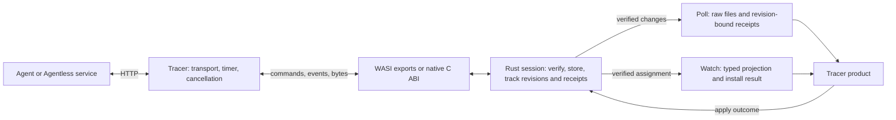
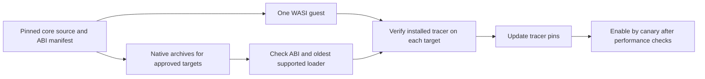

# Reactor architecture and rollout

Use one Rust session and one conformance suite. Choose one backend per tracer after measuring it in an installed application. Keep the existing backend as the default until the replacement meets the release criteria.

## Ownership

The tracer applies configuration. It does not reimplement file verification, assignment ordering, or receipt matching. An asynchronous product keeps a receipt identifier, not a borrowed payload. A watch reports success only after installation. The next request carries the accepted outcomes.

The tracer loads the backend from its Remote Config polling loop when Remote Config is enabled. In Node.js, the synchronous guest and native calls run on the application thread. A span reads installed settings without crossing either ABI.

## Backend selection

| | WASI | Native FFI |
| --- | --- | --- |
| Delivery | One guest can serve different operating systems and architectures. Each tracer still needs a compatible WASI host. | Each target needs a native binary. Package it with the tracer and reuse its existing signing and loading path. |
| Execution | Guest memory is separate from host memory. The host copies input to the guest and must check memory ranges. Engine setup and compilation add startup cost. | Skip guest compilation and use native instructions. A synchronous host call can borrow memory. A native pointer or lifetime error can affect the process. |
| Maintenance | Update one guest per core revision. Qualify the host engine and package on each target. | Rebuild and qualify each artifact from the same revision. Check the loader, dependency versions, and ABI on each target. |

Start with direct WASI for Node.js and Go. Node.js can use its existing runtime without an addon. Go can embed the guest and keep cgo off.

The Go native PoC worked without cgo on macOS. Its cgo-free Linux x64 executable requests glibc's loader and fails on stock Alpine. A dynamically linked cgo build loaded the musl reactor and passed the lifecycle, APM, and OpenFeature tests. Native delivery also needs a library for each platform.

The Node.js 26 prototype calls the native reactor directly with the experimental `node:ffi` module. The Node.js 22 runtime used for the WASI checks has no `node:ffi` module. A tracer-owned Node-API addon could cover those older releases. It would need an addon and a matching reactor library for each OS, architecture, and libc. It would also need to copy the output it hands to JavaScript before releasing the reactor buffers.

Start with JNI for Java and native interop for .NET. JNI covers Java 8 without a WASI engine. The .NET native worker avoids loading Wasmtime. In the Java loopback test on macOS ARM64 with JDK 25, median process CPU per 24-file poll was 0.788 ms for the current worker, 0.615 ms with JNI, and 19.426 ms with Endive WASI. Keep alternative backends out of shipped packages unless a tracer has a separate, measured need.

The .NET native worker passed on Ubuntu and Alpine ARM64. The pinned Wasmtime package requires glibc. A memory-backed transport test on Ubuntu ARM64 included both reactor backends. The median for a 24-file poll was 332 µs in the current tracer, 537 µs with WASI, and 283 µs with native interop. The current tracer led unchanged and single-file polls.

A separate macOS ARM64 test used the live .NET workers and a loopback Agent. Across five trials of 1,800 24-file polls per worker, the median process CPU time per poll was 984 µs for the current worker, 999 µs for raw native, and 1,109 µs for native watch. Managed allocation per poll was 337 kB, 320 kB, and 331 kB, respectively. The memory-backed test gives the reactor backends an extra full response copy. The live native worker streams the response into one buffer.

On Linux ARM64 with .NET 10.0.15, the live worker test compared the current tracer with the original and glibc 2.17 native archives in ten balanced rounds. For 24-file updates, median process CPU per poll was 719 µs for the current tracer, 728 µs for raw native with the rebuilt archive, and 767 µs for native watch with that archive. Managed allocations were 329, 312, and 324 KiB per poll. The raw worker's paired CPU change for one-file polls was +3.5% between the archives in the first run and +0.3% in a focused repeat.

Time unchanged polls and changed batches separately. Native reduced the cost of large updates in some local tests and increased CPU on some unchanged polls. Measure application tail latency and total memory separately.

Compile SHA-2 for speed in the WASI build. Keep the size profile for the rest of the guest. This cut 24-file update time by 40% in Go and CPU by 24% in Node.js compared with the size profile alone. Go's cold worker start stayed at about 235 ms. The current tracers led both large-update tests.

The Node.js watch reads payloads only for changed revisions. The Rust session preserves Agent response order for upserts and keeps snapshot positions stable. The host merges cached projections and publishes them after installation. When one of 24 files changed per poll, the same WASI guest used 370 µs of CPU before the host change and 287 µs after it. Stock used 184 µs per poll in the second run. The all-files result moved within observed variation.

The installed Node.js comparison used 8,000 requests per second and the default five-second poll interval on Alpine ARM64. Both previews had higher median p99 around changed replies. Identical stock runs varied widely, so this test leaves application latency open for both previews.

The Linux ARM64 .NET application test used the five-second poll interval and 2,000 requests per second with one manual span per request. Whole-run socket p99 was 203 µs higher for native at the paired median in the pilot. It was 250 µs lower in a repeat that reserved separate CPUs for the app, Agent, and driver. The repeat measured 612,000 requests. Its identical current-worker controls differed by 320 µs at the median. Qualify application latency before changing the default.

The same CPU-pinned harness measured another 612,000 requests with the revised .NET candidate and the installed glibc 2.17 archive. The native worker allocated 10.1 fewer managed bytes per request at the paired median and allocated less in all six rounds. Socket p99 differed by up to 313 ms between identical managed-worker controls, so this run leaves the latency effect unresolved.

## Release and repair

Bundle the guest in the Node.js preview archive. The preview opens it from its installed package directory. Clean installs on macOS and Alpine ARM64 applied and acknowledged all measured updates without a path override.

The guest added 402 KB to the compressed tracer archive in the local test. A separate data package keeps that cost with users who install the guest. It adds another publication and version pin. Bundling the guest in the preview keeps the loader and guest on one release.

- Build artifacts in a trusted release job. Record the source revision, artifact digest, ABI, target, and runtime requirements. A checksum alone does not identify a trusted producer.
- Check GNU/Linux imports against the oldest supported glibc and load the extracted archive on that version. The linker's sysroot sets the symbol versions even when the target triple stays the same.
- Qualify the installed package on its actual OS, architecture, and libc. A build, an archive, and a loopback fixture do not by themselves qualify an installed tracer.
- Run common protocol fixtures through the tracer. Compare installed settings and outgoing receipts. Check disabled startup, missing or incompatible artifacts, cancellation, and shutdown.
- Measure cold startup, retained memory, and application tail latency. Use the normal poll interval and include unchanged polls and large updates.
- Ship a protocol correction from one core revision. Rebuild its artifacts and update all tracer pins. If activation fails, do not replace trusted settings with unverified data.
